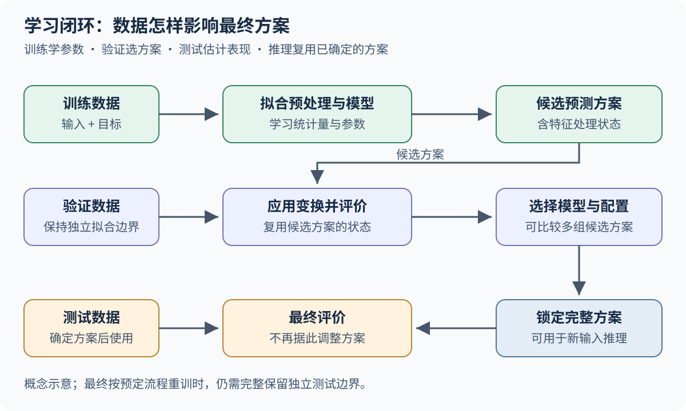

# 机器学习概念与任务

[[AI/00-知识库总览|总览]] · [[AI/01-数学与编程基础/00-模块索引|模块索引]] · [[AI/02-学习资料与论文索引|资料索引]]

> [!abstract] 先抓住主线
> 机器学习用数据确定模型的行为。一个学习问题需要同时说清 **数据是什么、允许怎样的模型、按什么目标学习、如何检验新数据上的表现**。深度学习用多层神经网络学习表示，属于机器学习的方法体系。训练得到参数，推理使用参数；训练集上的拟合效果不能直接代表泛化能力。

**前置：** 无额外专题前置。本篇先建立语义，数学记号在后续几篇展开。

## 1. 从一个预测问题认识学习

设想要在包裹发出时预测运输时长。人工写规则可以规定“距离远就加时”，但距离、重量、运输方式之间可能存在复杂关系。机器学习改为：收集历史包裹，在明确的模型类中，寻找使预测与已知时长相符的函数。它仍依赖人对问题、数据、模型和目标的选择，并不会自动知道什么业务规律应当成立。

用下列**原创教学数据**贯穿说明：

| 样本 | 距离 / 百公里 | 重量 / 千克 | 实际时长 / 小时 |
| --- | --- | --- | --- |
| 1 | 1 | 1 | 3 |
| 2 | 2 | 1 | 5 |
| 3 | 1 | 3 | 4 |

每一行是一个样本（sample），输入列是特征（feature），要预测的时长是标签或目标（label/target）。监督学习的数据记为

$$
\mathcal D=\{(x_i,y_i)\}_{i=1}^{n},\qquad x_i\in\mathbb R^d.
$$

这里 $n=3,d=2$。单个输入 $x_i$ 是列向量，全部输入按行堆成 $X\in\mathbb R^{n\times d}$。一个简单模型为

$$
\hat y=f_\theta(x)=w^\top x+b,\qquad \theta=(w,b).
$$

$w$ 决定每个特征怎样影响输出，$b$ 是偏置。若取 $w=(2,0.5)^\top,b=0.5$，预测恰好是 $(3,5,4)$。这只是人为构造的例子：**拟合这三行，不足以证明规律适用于新包裹**。本篇关于数据、模型、目标和优化的分工对应 [D2L 1.2](https://d2l.ai/chapter_introduction/index.html#key-components)。

## 2. 模型、目标与算法各自负责什么

| 对象 | 回答的问题 | 例子 |
| --- | --- | --- |
| 模型类 / 假设空间 | 允许学习什么函数？ | 所有 $w^\top x+b$，或某种神经网络 |
| 参数（parameter） | 这个函数具体是什么？ | 学得的 $w,b$ |
| 损失（loss） | 单个预测错得有多严重？ | 平方误差 $(\hat y-y)^2$ |
| 学习目标（objective） | 整体要最小化什么？ | 平均损失加正则项 |
| 优化算法 | 如何找到较好的参数？ | 梯度下降 |
| 超参数（hyperparameter） | 如何配置学习过程或模型类？ | 学习率、树深、正则强度 |
| 评价指标（metric） | 怎样判断结果有用？ | MAE、召回率、延迟等 |

例如最小化均方误差（mean squared error, MSE）：

$$
\hat\theta=\arg\min_\theta\frac1n\sum_{i=1}^{n}(f_\theta(x_i)-y_i)^2.
$$

$\arg\min$ 返回使目标尽可能小的**参数**，$\min$ 返回目标的**数值**。平方误差是一种选择；如果实际更在意极端延误，就需要重新考虑损失和指标，而不是默认数学上方便的目标就是最终需求。

> [!note] 学习目标与评价指标可以不同
> 分类时常用可微的交叉熵训练，用准确率、F1 或召回率评价。因为指标可能不可微，或不能给出足够有效的梯度。优化器只直接看到训练目标；目标是否符合实际用途，仍需要验证。

模型复杂度也不是参数数目这一个数字决定的。特征表示、结构约束、正则化和数据量都会影响模型可表达的规律与泛化，详见 [[AI/02-数据与机器学习基础/03-学习目标、泛化与正则化|学习目标、泛化与正则化]]。

## 3. 训练、验证、测试、推理

**训练（training）**用训练数据调整参数；**验证（validation）**用来比较模型、选择超参数、决定停止位置；**测试（testing）**在方案确定后估计表现。验证集参与了选择，因而最终报告不能把验证分数当成完全独立的检验。

**推理（inference）**是给定输入，用已确定的模型产生输出。监督学习推理通常不需要真实标签；真实标签在之后到达时才可用于评价。已训练模型还依赖同一套特征顺序、编码和标准化参数，不能只保留权重。

图为原创教学示意，强调数据用途：训练与验证共同决定最终方案；测试数据只进入最后评价。图中“锁定”表示锁定包括预处理在内的整个预测方案。来源依据与渲染范围见 [图示说明](../assets/figures/README.md)。

> [!warning] “没有使用标签”也可能泄漏
> 在全体数据上计算均值、建立词表、选择特征，再划分训练与测试，会让测试数据影响学习过程。可信评估要求先确定数据边界，再在训练范围内拟合需要学习的步骤。详见 [[AI/02-数据与机器学习基础/02-数据划分与数据泄漏|数据划分与泄漏]]。

## 4. 学习方式按信号来源区分

| 方式 | 学习信号从哪里来？ | 典型目的 |
| --- | --- | --- |
| 监督学习（supervised） | 给定输入及其目标 | 从特征预测类别、数值或结构 |
| 无监督学习（unsupervised） | 数据本身的结构与分布 | 聚类、降维、密度估计 |
| 半监督学习（semi-supervised） | 少量标注加大量未标注数据 | 利用未标注数据辅助同一任务 |
| 自监督学习（self-supervised） | 从数据自动构造预测目标 | 预测遮挡内容、下一个词、不同视图的一致性 |
| 强化学习（reinforcement learning） | 与环境交互获得的奖励 | 优化行动序列的长期回报 |

自监督不等于没有目标，而是目标通常来自数据自身；在广义分类中常被归入无监督表示学习。强化学习的动作会改变后续观察，奖励又可能延迟，因此不能直接视为“标签晚一点给出的普通分类”。相关任务图景见 [D2L 1.3](https://d2l.ai/chapter_introduction/index.html#kinds-of-machine-learning-problems)。

深度学习（deep learning）是一种**表示与建模方法**，不是与监督学习并列且互斥的信号来源。神经网络可以用于监督、自监督或强化学习。人工智能（AI）范围更广，还包含搜索、规划、知识表示等；不是所有 AI 系统都需要从数据学习。

## 5. 任务按输出和用途区分

- **回归（regression）**：输出数值，如时长；数值标签不一定意味着回归，数字形式的类别 ID 仍可属于分类。
- **分类（classification）**：预测离散类别或类别概率。二分类、多分类与多标签分类的输出约束不同。
- **聚类（clustering）**：按给定表示与相似度形成组，没有天然唯一正确的分组。
- **降维（dimensionality reduction）**：把高维输入映射到低维表示，目标可以是重构、保留方差或局部邻域。
- **异常检测（anomaly detection）**：给出异常分数或判定；异常的定义依赖参考分布。
- **排序（ranking）**：在查询或上下文下排列候选项，重点是相对次序。
- **生成（generation）**：学习分布并构造新的样本或序列，也可以受输入条件控制。

同一系统常包含多个任务：先检索候选项，再排序，再生成文本。应先辨认每一步的输入、输出、目标与评价，不能只用一个模型名字代替问题定义。

## 6. 为什么学习的核心是泛化

训练样本只是总体的一部分。我们通常真正关心的是新样本上的期望损失

$$
R(\theta)=\mathbb E_{(x,y)\sim P}[\ell(f_\theta(x),y)].
$$

$P$ 是目标数据分布，训练集平均损失只是它的一个样本近似。独立同分布（i.i.d.）是常用分析起点，现实中的时间变化、群体差异和采样偏差会破坏这一近似。更多数据只有在与目标相关、标签和采集过程合理时，才可能有效改善学习。

预测关系也不自动提供因果结论。模型可能学到某种包装与运输时长相关，却不能据此断定“改用这种包装必然缩短时长”。统计学习中的预测、解释与误差问题可对照 [ISLP 官方教材入口](https://www.statlearning.com/)。

**知识连接：** [[AI/01-数学与编程基础/02-线性代数与矩阵分解|线性代数]]说明输入怎样表示；[[AI/01-数学与编程基础/04-概率统计与参数估计|概率统计]]说明分布与估计；[[AI/01-数学与编程基础/05-优化与数值计算基础|优化]]说明参数如何更新。三者将在 [[AI/03-经典机器学习算法/01-线性回归与正则化|线性回归]]汇合，神经网络进一步学习中间表示。

## 资料与阅读定位

- **T03 · Zhang、Lipton、Li、Smola，D2L 1.0.3，第 1 章**：[Introduction](https://d2l.ai/chapter_introduction/index.html)，已读 §1.2–1.3 的对象与任务说明，用于核对学习问题的组成。
- **T04 · James 等，ISLP（2023）**：[教材与官方课程](https://www.statlearning.com/)，第 2 章为预测、解释、误差与统计学习的补充阅读入口；本篇未据其目录声称已通读该章。

教学数据和数值为本笔记自行构造，不是教材实验结果。基础概念以教材为主，不为本篇机械附加原始论文。
