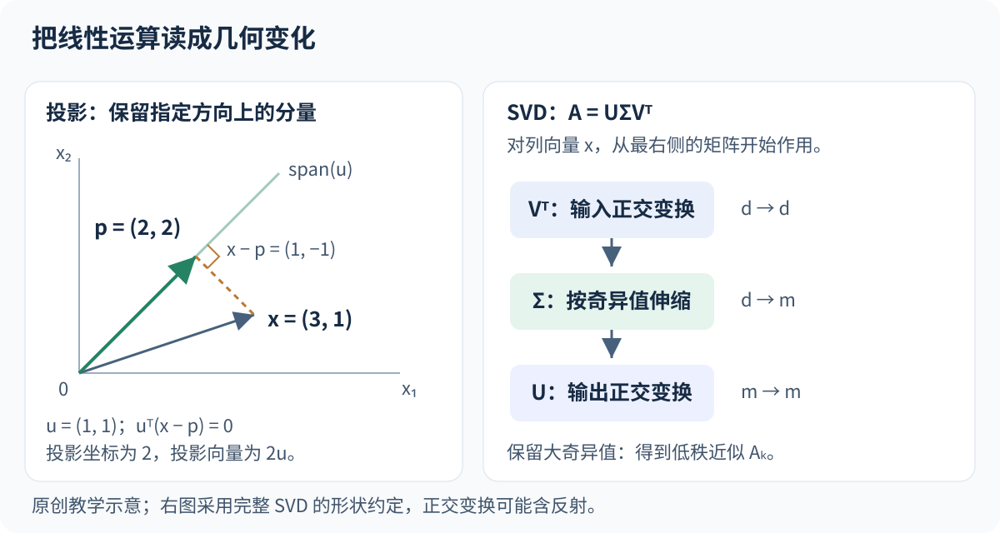

# 线性代数与矩阵分解

[[AI/00-知识库总览|总览]] · [[AI/01-数学与编程基础/00-模块索引|模块索引]] · [[AI/02-学习资料与论文索引|资料索引]]

> [!abstract] 先抓住主线
> 向量表示一个对象，矩阵同时表示一批对象或一个线性变换。内积衡量方向上的匹配，投影保留某个子空间内的信息；特征分解寻找不变方向，SVD 把任意实矩阵拆成正交变换与伸缩。回归、PCA、低秩近似和神经网络层都建立在这些操作上。

**前置：** 基本实数运算。本篇采用列向量；数据矩阵按“每行一个样本”组织。

## 1. 先认对象与形状

| 对象 | 记号与形状 | 在模型中的含义 |
| --- | --- | --- |
| 标量（scalar） | $b\in\mathbb R$ | 一个偏置或一个损失值 |
| 向量（vector） | $x\in\mathbb R^d$ | 一个样本的 $d$ 个特征 |
| 矩阵（matrix） | $X\in\mathbb R^{n\times d}$ | $n$ 个样本，每行是 $x_i^\top$ |
| 多维数组 / 张量（tensor） | 如 $B\times C\times H\times W$ | 一批图像；每个轴有具体语义 |

机器学习程序中的 tensor 通常指多维数组；理解计算时应同时知道形状、轴的意义、数据类型和设备。仅看“都是四维”不能判断两个图像数组能否直接相乘。对象与基本运算可对照 [D2L 2.3](https://d2l.ai/chapter_preliminaries/linear-algebra.html)。

对 $A\in\mathbb R^{m\times d}$、$B\in\mathbb R^{d\times k}$，

$$
(AB)_{ij}=\sum_{r=1}^{d}A_{ir}B_{rj},\qquad AB\in\mathbb R^{m\times k}.
$$

收缩的是中间维度 $d$。矩阵乘法通常不满足交换律；$(AB)^\top=B^\top A^\top$。逐元素乘法 $A\odot B$ 则比较相同位置，与矩阵乘法是不同的运算。

例如

$$
X=\begin{bmatrix}1&1\\2&1\\1&3\end{bmatrix},\quad
w=\begin{bmatrix}2\\0.5\end{bmatrix},\quad b=0.5,
$$

则 $Xw=(2.5,4.5,3.5)^\top$，再加 $b\mathbf1_3$ 得 $(3,5,4)^\top$。数学上要写出全 1 向量；程序中通常用广播完成。

> [!warning] 形状相容不代表语义正确
> 一个长度 $n$ 的标签向量与形状 $(n,1)$ 的预测数组相减，某些数组库会广播成 $(n,n)$，得到两两差值。先明确目标输出应为 $(n,)$ 还是 $(n,1)$，再进行运算。详见 [[AI/01-数学与编程基础/08-科学计算与可视化|数组与广播]]。

线性空间是在向量加法与数乘下封闭的集合；一组基既线性独立，又能张成整个空间。基的个数是空间维度，坐标是向量在这组基下的系数。换基改变坐标表示，不改变所表示的对象。线性变换满足 $T(ax+bz)=aT(x)+bT(z)$，在给定基下由矩阵表示；加上非零偏置后则是仿射变换，不再严格满足 $T(0)=0$。

## 2. 内积、长度、夹角与投影

内积 $x^\top z=\sum_jx_jz_j$ 是一个标量。欧氏长度 $\|x\|_2=\sqrt{x^\top x}$；若 $x,z\ne0$，则

$$
\cos\angle(x,z)=\frac{x^\top z}{\|x\|_2\|z\|_2}.
$$

内积同时受方向和长度影响；余弦相似度消去长度信息，但在零向量上未定义。特征单位不同也会改变距离和相似度，这解释了近邻、聚类和线性模型为什么常需要检查尺度。

把 $x$ 投影到非零向量 $u$ 张成的直线上，设投影为 $au$。最小化距离平方：

$$
\|x-au\|_2^2=x^\top x-2a u^\top x+a^2u^\top u.
$$

对 $a$ 求导并令其为零，得到

$$
a=\frac{u^\top x}{u^\top u},\qquad
\operatorname{proj}_u(x)=\frac{u^\top x}{u^\top u}u.
$$

例如 $x=(3,1)^\top,u=(1,1)^\top$，$a=2$，投影为 $(2,2)^\top$，残差 $(1,-1)^\top$ 与 $u$ 正交。投影是在指定子空间中找最接近的点，不是逐元素截断。

若 $Q\in\mathbb R^{d\times k}$ 的列正交归一，即 $Q^\top Q=I_k$，则投影矩阵 $P=QQ^\top$ 满足 $P^\top=P$、$P^2=P$。坐标是 $Q^\top x$，重构是 $QQ^\top x$。这个“低维坐标—重构”的区分直接进入 [[AI/03-经典机器学习算法/08-降维与低维可视化|PCA]]。

原创示意：左侧虚线连接原向量和投影，表示被丢弃的正交残差；右侧按列向量从 $V^\top$、$\Sigma$ 到 $U$ 读取。图示说明见 [资产说明](../assets/figures/README.md)。

## 3. 范数、秩与线性方程

向量常见范数为 $\|x\|_1=\sum_j|x_j|$、$\|x\|_2$、$\|x\|_\infty=\max_j|x_j|$。矩阵的 Frobenius 范数 $\|A\|_F=\sqrt{\sum_{ij}A_{ij}^2}$ 衡量全部元素的平方总量。后面的 L1/L2 正则就是对参数施加这样的约束或惩罚。

矩阵的秩（rank）是独立列的最大数目，也等于独立行的最大数目。列空间 $\operatorname{col}(A)$ 包含所有可表示为 $Ax$ 的输出，零空间包含所有满足 $Ax=0$ 的输入。

对 $Ax=b$：若 $b$ 不在列空间中就无精确解；若存在非零零空间，则在一个解上加零空间向量仍是解。只有方阵且满秩时才存在通常意义的逆矩阵。回归常面对超定、欠定或近似相关的特征，所以“求一个逆”不是通用解法。

最小二乘在没有精确解时求

$$
\hat w=\arg\min_w\|Xw-y\|_2^2.
$$

最优残差与 $X$ 的每一列正交，于是 $X^\top(X\hat w-y)=0$。若 $X$ 列满秩，形式解为 $(X^\top X)^{-1}X^\top y$；数值计算通常选 QR/SVD 或专门的最小二乘求解器，避免显式求逆和病态性的放大。后续见 [[AI/03-经典机器学习算法/01-线性回归与正则化|线性回归]]。

## 4. 特征分解：寻找变换下不变的方向

若 $Av=\lambda v$、$v\ne0$，则 $v$ 是特征向量（eigenvector），$\lambda$ 是特征值。作用在这个方向时，$A$ 只做缩放或反向。一般方阵未必能在实数域对角化；存在足够多独立特征向量时才可写 $A=V\Lambda V^{-1}$。

**实对称矩阵**有更强保证：

$$
A=Q\Lambda Q^\top,\qquad Q^\top Q=I.
$$

即总能选择一组实的正交归一特征向量。若还满足对任意 $x$ 有 $x^\top Ax\ge0$，称对称半正定（positive semidefinite, PSD），等价于全部特征值非负。协方差矩阵、$X^\top X$ 和适当定义的核 Gram 矩阵都是关键例子。定义与条件见 [《Deep Learning》§2.7](https://www.deeplearningbook.org/contents/linear_algebra.html)。

例如 $A=\begin{bmatrix}2&1\\1&2\end{bmatrix}$ 在 $(1,1)^\top/\sqrt2$ 方向伸长 3 倍，在 $(1,-1)^\top/\sqrt2$ 方向伸长 1 倍。特征值相同的子空间内可以更换正交基；即使特征值不同，向量的正负号也不唯一。

## 5. SVD：矩形矩阵也能分解

对任意 $A\in\mathbb R^{m\times d}$，奇异值分解（singular value decomposition, SVD）为

$$
A=U\Sigma V^\top,
$$

其中完整形式 $U\in\mathbb R^{m\times m}$、$V\in\mathbb R^{d\times d}$ 为正交矩阵，$\Sigma\in\mathbb R^{m\times d}$ 的对角线上为非负奇异值。对列向量计算 $Ax$，先由 $V^\top$ 变换输入坐标，再由 $\Sigma$ 伸缩并改变维度，最后由 $U$ 变换到输出坐标。正交变换可能包含反射，不应一律叫作旋转。

因为 $A^\top A=V\Sigma^\top\Sigma V^\top$，非零奇异值满足 $\sigma_j=\sqrt{\lambda_j(A^\top A)}$。保留前 $k$ 个奇异值得到

$$
A_k=\sum_{j=1}^{k}\sigma_j u_jv_j^\top.
$$

在 Frobenius 范数下，它是秩不超过 $k$ 的最佳近似之一，误差平方为 $\sum_{j>k}\sigma_j^2$；奇异值重复时最佳解可能不唯一。定义可对照 [《Deep Learning》§2.8–2.9](https://www.deeplearningbook.org/contents/linear_algebra.html)。例如 $\operatorname{diag}(3,1)$ 的秩 1 截断为 $\operatorname{diag}(3,0)$，损失的平方能量是 1。

把非零奇异值取倒数、零保留为零，可构造伪逆 $A^+$；$A^+b$ 给出最小二乘解中欧氏范数最小的一个。很小的奇异值取倒数会放大噪声，因此数值求解还需要截断阈值或正则化。

## 6. 与后续模型的连接

对按列中心化的数据 $X_c\in\mathbb R^{n\times d}$，若 $n>1$，样本协方差为 $C=X_c^\top X_c/(n-1)$。PCA 选取 $C$ 最大特征值对应的方向，也等价于取 $X_c$ 的右奇异向量。**中心化决定这里表示的是围绕均值的变动**；未经中心化的分解回答的是另一个问题。

神经网络的线性层是 $XW+\mathbf1b^\top$，其中 $W\in\mathbb R^{d\times h}$；与单个样本的 $w^\top x+b$ 只是约定和维度不同。注意力中的相似度矩阵与低秩微调也会反复使用内积、矩阵乘法和秩的概念。

> [!note] 三个需要分开的“维度”
> 特征数量是输入坐标数；秩是线性独立信息的数量；流形维度描述数据局部变化可能所需的自由度。它们可以不同，不能因 SVD 中存在小奇异值就断言所有数据都有同样低的非线性内在维度。

## 资料与阅读定位

- **T03 · D2L 1.0.3**：[§2.3](https://d2l.ai/chapter_preliminaries/linear-algebra.html)，已核对对象、矩阵运算、轴与范数的相关正文。
- **T06 · Goodfellow、Bengio、Courville，Deep Learning（2016）**：[第 2 章](https://www.deeplearningbook.org/contents/linear_algebra.html)，已核对 §2.7–2.9 的分解条件与定义，§2.12 为 PCA 继续阅读入口。
- **T05 · Deisenroth、Faisal、Ong，MML（2020）**：[作者公开版](https://mml-book.github.io/)，第 2–4 章供线性空间、几何与分解的系统补充；本轮 PDF 抓取受大小限制，未将其标为章节已读。

本篇的投影、预测与对角矩阵例子为自行推导，核查集中于形状、正交残差和重构误差；不是算法复现实验。
