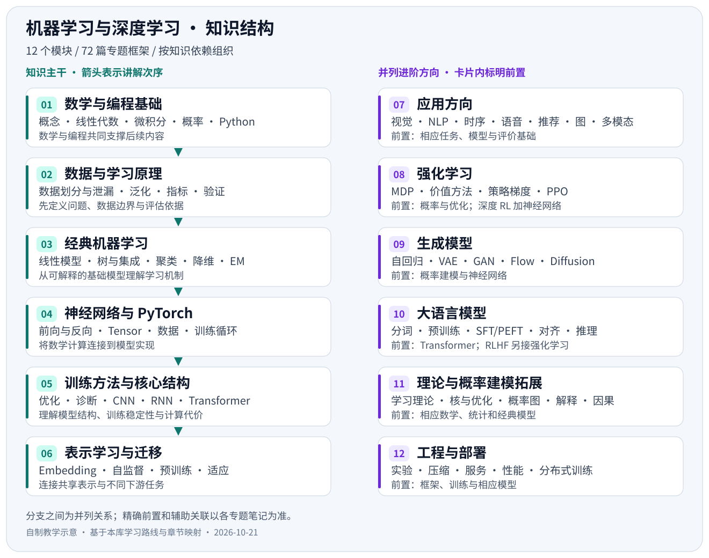

# 笔记编写约束

本约束适用于 `AI/` 下的机器学习与深度学习笔记。目标是形成能够独立理解、逐步深入、可追溯到教材与论文的中文学习材料。当前交付是框架，详细正文在后续按主题补充；用户后续的明确要求优先于本约束。

## 1. 范围与组织

- 以 [[AI/机器学习与深度学习学习路线|学习路线]] 为内容边界，用 [[AI/03-路线与章节映射|路线与章节映射]] 保证知识点有入口。
- 编号表示目录与知识依赖，不表示天数、周数或学习进度安排。不自行添加时间计划、项目清单或打卡任务。
- 通用基础与进阶分支分开；明确真正的前置知识与仅有助理解的关联内容。Transformer 可关联 RNN，不把完整 RNN 课程强加为数学前置。
- 当前框架仅填写范围、提纲、前置、资料、后续展开重点与拟配图示；不批量生成泛泛正文，不填造实验结果。
- 每篇围绕一个主要问题。存在独立目标、损失、数据或评价方法的大主题可以继续拆分，拆分后维护入口、双向关联和路线映射。
- 不借用本 Vault 其他目录的笔记作为技术正文来源，除非用户明确指定；外部教程、论文和官方文档独立核对。
- 不修改 Vault 的主题、插件、字体与工作区设置。新增内容与资产限制在 `AI/`。

## 2. 教材、课程和实现的分工

教学主线以吴恩达机器学习/深度学习专项、D2L、ISLP 为主；数学与理论结合 MML、Deep Learning、CS229。应用与进阶部分用相应的专门课程补足，书目见 [[AI/02-学习资料与论文索引|资料与论文索引]]。

| 资料类型 | 在笔记中的用途 | 引用要求 |
| --- | --- | --- |
| 主流教程、权威教材 | 讲解概念、建立顺序、补充推导和案例 | 写到课程名/教材版本与具体章节；目录链接只能证明覆盖范围 |
| 原始论文 | 方法定义、训练目标、结构、实验结论和历史来源 | 优先作者页、arXiv、会议/期刊官网；引用实际读到的版本与位置 |
| 官方实现和 API 文档 | 参数语义、默认行为、数值细节、版本差异 | 给出项目、版本/tag/commit 与文档或源码入口 |
| 综述、作者教程 | 整理方法谱系、比较和研究背景 | 标明属于综述或教学解释，不替代具体方法的原文 |
| 自行推导、教学示例 | 连接概念和帮助理解 | 明确“教学推导/简化示例”，说明假设；不能冒充论文原有结论 |

默认用 Python、NumPy、scikit-learn 和 PyTorch 承接实现。课程使用 TensorFlow 或 R 时保留原资料信息，说明笔记中的实现对应；不声称不同框架、版本或设备会得到完全相同结果。当前阶段不凭在线文档的版本号推定本机安装环境。

## 3. 完整正文的讲解结构

下表是内容要求，不要求每篇机械使用完全相同的标题。概念之间用连贯解释连接，表格适合比较，不能用术语表代替原理。

| 层次 | 应回答的问题 | 写法 |
| --- | --- | --- |
| 快速建立直觉 | 解决什么问题，输入输出是什么，为什么需要它？ | 一段概述，配一个贯穿例子；首次出现的术语给出中文、英文与缩写 |
| 问题与假设 | 数据、标签、变量、分布和使用条件是什么？ | 明确任务、假设、目标与评价对象，区分训练、验证和推理 |
| 核心机制 | 每个步骤怎样发生，前后如何连接？ | 从简单特例到一般形式；复杂过程用合适的图辅助 |
| 数学表达 | 符号是什么意思，公式从何而来？ | 解释符号、维度、条件和关键变形，不跳过决定理解的步骤 |
| 计算示例 | 具体数字如何经过这个机制？ | 手算、小型数组或可跟踪的例子，给出中间值与检查方式 |
| 实现对应 | 数学对象如何映射到程序？ | 先最小逻辑/伪代码，再解释框架接口；明确代码验证状态 |
| 使用与边界 | 何时适用，常见失败和混淆有哪些？ | 给出条件、反例、代价与相邻方法比较 |
| 资料追溯 | 每个关键定义、结构或结论依据什么？ | 关键位置就近引用，文末列书目与阅读定位 |

对于长文，开头保留简短概览，推导、实现与拓展分层。读者应能先理解主要机制，再进入数学与代码；不得要求先通读全部参考资料才能看懂正文。

## 4. 详细程度

### 4.1 统一深度

- **概念理解**：可以用自己的话解释任务、核心机制、输入输出、假设和局限。
- **关键推导**：核心算法与数学主题应能沿笔记复核目标函数、主要更新式和形状关系；基础等式不逐字展开，关键跨越必须解释。
- **实现对应**：涉及算法或框架时，应能把符号和流程对应到最小实现，理解损失、参数、梯度、数据维度与评价。
- **研究拓展**：说明相邻方法、历史版本或论文差异；高阶证明和非主干变体放在独立拓展中，不阻塞入门正文。

字数用于控制粒度，不作为凑字指标：简单工具/单概念通常约 800–1,800 中文字，核心算法/原理约 2,000–4,000 字；大型架构与理论主题按需要拆分。公式、代码和图示另计；解释完整和阅读清晰优先。当前框架不执行这些正文篇幅。

### 4.2 各部分的具体要求

| 部分 | 正文应达到的程度 | 推导/实现与教学重点 |
| --- | --- | --- |
| 01 数学与编程基础 | 概念、几何/概率直觉与模型中的用途同时清楚 | 维度、投影、链式法则、MLE/MAP、概率损失、稳定计算；程序主题给输入输出与形状示例 |
| 02 数据与机器学习基础 | 能解释评估为什么可信，以及如何避免泄漏 | 数据流、拟合范围、指标手算、交叉验证和不确定性；示例明确训练/验证/测试边界 |
| 03 经典机器学习算法 | 直觉—目标—求解—预测—局限形成闭环 | 线性/Logistic 回归、PCA、EM、SVM 展开关键推导；树与聚类提供可手算步骤及框架对应 |
| 04 神经网络与 PyTorch | 能跟踪一次前向、反向、更新和恢复 | 小网络完整反向传播、数值梯度检查、Tensor 形状、计算图、训练模式与梯度模式 |
| 05 训练方法与核心结构 | 能解释结构为何这样设计，怎样影响梯度与资源 | 更新式、归一化轴、残差尺寸、卷积尺寸、时间展开、Q/K/V 与 Mask；曲线注明来源 |
| 06 表示学习与迁移 | 明确信号来源、表示用途和迁移边界 | 训练目标、正负样本、掩码、冻结/微调、域偏移和遗忘；比较方法时保持数据条件一致 |
| 07 应用方向 | 以任务、数据、输出、损失和指标组织 | 每个方向有代表模型与一个完整小例子；共享网络原理链接到主干，行业/模型变体按需另拆 |
| 08 强化学习 | 分清环境、采样、估计和优化 | 小 MDP、Bellman、TD/Q 更新、策略梯度与 PPO；明确信息可见性和 On/Off-policy |
| 09 生成模型 | 目标、概率假设、训练与采样路径清楚 | 链式分解、ELBO、对抗目标、变量替换、扩散目标；明确示例简化与生成评价条件 |
| 10 大语言模型 | 从语料到目标、微调、对齐、推理和评估可串联 | Tokenization 工具/算法区分、BERT/GPT、LoRA 形状、RLHF/DPO、KV Cache、污染与能力评价 |
| 11 理论与概率建模拓展 | 定义、假设、结论、证明思路和适用边界齐全 | 主要命题可复核；复杂证明可链接原文并解释关键步骤；区分相关、解释与因果 |
| 12 工程与部署 | 数据、模型、版本、资源和监控能对应 | 指标口径、导出与运行时、并行/通信、Checkpoint、漂移；区分理论复杂度与实测性能 |

## 5. 公式与符号

- 使用 Obsidian 原生 LaTeX 数学格式：行内 `$...$`、独立公式 `$$...$$`。不依赖额外插件。
- 定义样本数、特征维度、批量、序列长度、类别数等符号；同篇保持一致，跨篇改变时明确说明。
- 矩阵乘法、广播、归一化、注意力与反向传播标明张量形状。注明行向量/列向量约定。
- 概率密度与概率、似然与后验、logits 与概率、期望风险与经验风险保持区分。
- 每个关键公式说明“表达什么、为何成立、哪些条件下成立、程序中对应什么”。
- 理论式、论文原式和实现稳定式存在差别时明确给出对应关系。公式改写和符号替换可追溯到原来源。

## 6. 引用资料与论文

### 6.1 引用位置和书目字段

重要定义、特定算法、结构图、公式、实验数字和结论都应在附近引用。文末书目只是索引，不代替正文中的依据。

- 教材/课程：作者或机构、标题、版次/年份、章节名（核对后可给章节号）、官方链接；动态网页记录访问日期。
- 论文：作者、完整题名、年份、稳定 URL（arXiv/DOI/正式论文页）、实际阅读版本；引用具体方法/结论时记录章节、公式、图或表的位置。
- 官方实现：仓库或文档、tag/commit/库版本、文件或 API 入口。仓库默认分支和 `stable` 是动态入口，运行示例前另锁版本。
- 每篇优先设置 1–2 个主教程入口、必要的实现文档及 0–3 篇直接相关论文；篇数不是硬限制。基础语法、数学和通用概念无需强配“最早论文”。
- 每条资料说明“看哪部分、帮助理解什么”。扩展资料与主要依据分开，避免只堆链接。
- 引用编号沿用 [[AI/02-学习资料与论文索引|全库 T/P 编号]]；新增编号追加，已有编号不重排。每篇仍应提供可直接打开的来源链接。

可使用 Markdown 脚注，格式如下；花括号内容在核对原文后替换：

```markdown
{基于原文解释的具体机制或结论}。[^P06]

[^P06]: Vaswani et al. *Attention Is All You Need*.
    https://arxiv.org/abs/1706.03762
    阅读版本与定位：{实际版本、章节/公式/图表，核对后填写}。
```

### 6.2 阅读状态和证据边界

| 状态 | 可以声称什么 |
| --- | --- |
| 入口/目录已核对 | 页面存在或能定位到对应主题；不代表已阅读全文 |
| 书目信息/摘要已核对 | 作者、标题、年份和摘要主题已核对；具体公式、实验和图仍需读全文 |
| 相关章节已读 | 可以引用已核对章节中的内容，保留定位 |
| 关键推导已核对 | 公式、条件、符号变换已复核；不自动意味着代码正确 |
| 代码静态检查 / 本机运行 / 结果复现 | 分别记录检查对象、环境、输入、输出和证据；三个状态不得互换 |

本次框架中的论文为书目/摘要入口，均未标记“已精读”。arXiv 年份默认记录首版提交年，与会议发表年分开。论文链接的存在不等于对全部结论、图片再使用许可或代码运行结果的认可。

### 6.3 论文内容的展开方式

逐篇补充时围绕“问题与背景—关键贡献—方法与目标—实验设置—主要结果—局限—与已有知识的联系”展开。明确作者主张、论文证据、自己的解释和未验证推断。论文中的相对提升、速度或资源数字必须同时给出数据集、基线、硬件/配置和评价口径；没有核对的数字暂不写入。

## 7. 示例与代码

- 示例围绕本篇主要问题，优先小型、可跟踪、可复核的数据；伪代码明确标记。
- 核心算法可先给 NumPy/数学最小版本，再连接 scikit-learn/PyTorch；一般工具主题直接使用官方接口。
- 代码写清依赖版本、输入输出、dtype/device、随机种子及运行方式。随机算法的结果允许有波动，不伪造固定分数。
- 明确 `zero_grad → forward → loss → backward → step` 等基本流程；梯度累积时另外说明清零和更新边界。
- 使用 `eval()` 控制模块行为，使用梯度上下文控制自动微分；用文字说明两者职责。
- 当前阶段只规划示例，不生成运行记录。未来有本机执行或复现时再增加数据、代码与记录文件。
- 完成与变更相关的必要验证即可，不为轻量文档机械添加实现镜像测试。

## 8. 教学配图

### 8.1 选择与用途

主动判断抽象概念、系统架构、工作流程和复杂原理是否需要图示。每张图承担一个清楚的教学问题，在正文中解释读图方法与图文对应关系。

优先选官方文档、开源项目和权威教材的高质量教学图；核对再使用许可，允许时下载至本地，并保留来源、作者和许可信息。公开可访问不自动代表允许复制。找不到合适且许可明确的图时制作原创示意图。

### 8.2 工具与视觉标准

| 图示内容 | 优先方式 |
| --- | --- |
| 架构、数据流、复杂流程、张量形状 | SVG、Graphviz、D2 等可控制布局的方案 |
| 数据分布、训练曲线、指标、数值模拟 | Python 等标准绘图工具；标明真实、模拟或概念示意 |
| 简单、节点较少的关系或时序 | 可用 Mermaid；根据可读性决定，不作为默认唯一工具 |
| 原图细节或高质量教学图复用 | 本地图片，保留比例、清晰度与许可说明 |

- 风格统一为简洁、现代、专业、层次清楚；使用清晰的方向、分组和少量强调色。
- Light/Dark 主题均可读：文字与线条有足够对比度，必要时使用明确的面板底色；不能仅依赖操作系统的颜色偏好。
- 关键节点、箭头方向、张量维度、因果/数据流语义必须准确。用颜色区分含义时同时给文字标识。
- 图中文字在笔记常用显示宽度下可辨认，避免重叠、裁切、交叉线和过密标签。
- 源文件优先保留 SVG/DOT/D2/Python，图片集中在 `AI/assets/figures/`。在图题附近写明原创/引用/改绘、来源、定位、许可和改动说明。
- Markdown 使用相对路径；框架阶段只写“拟配图”，不得插入指向尚不存在图片的占位引用。

插入现有本地图片的格式示例：

```markdown

```

子目录笔记需按所在位置调整相对路径。图示验证包括：文件存在、引用可解析、SVG/XML 或格式正确、实际渲染、文字与布局检查、明暗背景检查。渲染引擎检查和 Obsidian 应用实测分别记录。工具或网络受限时先合理尝试解决，仍受限则如实记录未完成项。

## 9. Markdown、状态与维护

- 正文使用中文，首次出现的重要术语补英文；标题描述具体内容。
- Obsidian 内部链接使用 Vault 相对完整路径并附短别名；表格中的别名分隔符写成 `\|`。只链接已创建的文件或有效标题。
- 主题笔记 YAML 至少包含 `id/type/status/layer/kind/sources`；框架状态为 `framework`，代码状态为 `not-added`，配图仅有设计时为 `planned`。
- 完整正文完成并校验后才能改为 `draft` 或 `reviewed`；“已读/已运行/已复现”各自有证据，不随文档状态自动升级。
- 每篇保留模块入口、前置/关联与资料索引；关键解释通过链接复用，避免多篇重复维护整段推导。
- 维护脚本只检查现有文件，不覆盖已补充的正文。新增、拆分或改名后同步 `AI/_维护/框架清单.json` 与路线映射。

## 10. 交付检查

扩写或重构后，按改动范围检查：

1. 该主题的路线知识点有覆盖，真正的前置依赖无循环；导航和引用可定位。
2. 概念、变量、形状、公式、假设和训练/推理差异准确。
3. 关键表述有就近来源；读到哪里、验证到哪里表达清楚。
4. 示例与代码状态真实，涉及数据划分的内容无泄漏。
5. 本地图示存在且实际渲染；来源、许可、明暗主题可读性和技术细节经过检查。
6. 未修改无关文件与 Vault 设置；报告已完成和仍待补充的内容。

不以达到固定字数、图片数或参考文献数代替内容质量。
